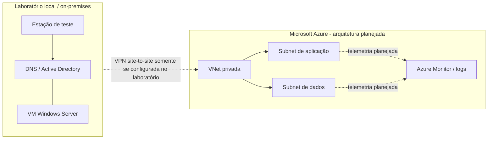

# Arquitetura de referência — laboratório híbrido

## Camadas a validar

1. **Identidade:** estado dos serviços de domínio, controlador acessível e permissões da conta de teste.
2. **Nomes:** consulta DNS no servidor esperado, nome completo (FQDN) e consistência das respostas.
3. **Rede:** rota, firewall e teste TCP na porta exigida pela aplicação. ICMP sozinho não comprova que um serviço está disponível.
4. **Serviço:** estado do serviço Windows e eventos pertinentes, sem coletar ou publicar informações confidenciais.
5. **Cloud:** quando houver VNet real no laboratório, revisar NSG, rotas e Network Watcher; não declarar a conexão ativa antes de testar.

## Fronteira entre realidade e planejamento

O diagrama é um modelo de referência. Só descreva AD, VPN, Azure e monitoramento como implementados quando houver configuração e evidência do seu próprio laboratório.
